# Purchase Demand Planning Process Flow

This sample flow is based on the implemented behavior in:

- `purchase_demand_planning`
- `purchase_demand_planning_central`

## Module Analysis

### `purchase_demand_planning`

This is the base purchase demand request module.

Main model:

- `purchase.demand.plan`

Main line model:

- `purchase.demand.plan.line`

Main responsibilities:

- Create purchase demand requests.
- Store requester, company, request date, delivery operation type, notes, and demand lines.
- Generate demand references by sequence:
  - Manual/import demand: `PDRM/%(day)s/%(month)s/%(year)s/#####`
  - Automatic demand: `PDRA/%(day)s/%(month)s/%(year)s/#####`
- Track demand header status.
- Track line-level requested, approved, and rejected quantities.
- Show stock quantity information and product forecast report access.
- Keep traceability to created RFQs and RFQ lines.

Header states:

- `draft`
- `submitted`
- `bu_approved`
- `central_approved`
- `rfq_created`
- `cancel`

Line states:

- `pending`
- `approved`
- `rfq_created`
- `rejected`

Implemented header transitions:

- `draft` -> `submitted`
- `submitted` -> `bu_approved`

### `purchase_demand_planning_central`

This module extends the base purchase demand request flow for central review and RFQ creation.

Main responsibilities:

- Add Central Demand Planning list view for demand lines.
- Add dashboard counters for all/my pending, approved, late, RFQ created, rejected, demand quantity, and approved quantity.
- Allow central users to approve or reject individual demand lines.
- Allow central users to approve or reject all eligible lines on a demand request.
- Create RFQs from approved demand lines.
- Support single-vendor and multi-vendor RFQ creation.
- Support splitting approved quantity across multiple vendor RFQ lines.
- Synchronize demand header state from line states.

Central line approval behavior:

- Approving a line requires `approved_qty > 0`.
- Rejecting a line sets `approved_qty = 0.0` and line state to `rejected`.

RFQ creation behavior:

- Only lines with state `approved` and no existing `rfq_line_ids` can be used.
- Vendor is required before RFQ creation.
- RFQs are grouped by company and vendor.
- Created RFQs use demand references as the purchase order `origin`.
- Demand lines are linked back to created RFQs and RFQ lines.
- Demand line state becomes `rfq_created`.

Header synchronization behavior:

- All lines `rfq_created` -> header becomes `rfq_created`.
- Lines only `approved` and/or `rfq_created` -> header becomes `central_approved`.
- All lines `rejected` -> header becomes `cancel`.
- Mixed rejected and approved lines do not change the header through line-level synchronization.

## Sample End-to-End Process

1. Requester creates a purchase demand request.
2. Requester adds demand lines with product, quantity, delivery date, preferred vendor, and remarks.
3. Requester submits the demand request.
4. Business Unit approver reviews and approves the request.
5. Central planning team reviews demand lines in Central Demand Planning.
6. Central planning team enters approved quantity for each accepted line.
7. Central planning team approves or rejects demand lines.
8. Approved lines become available for RFQ creation.
9. Central planning team opens the Create RFQ wizard.
10. Central planning team chooses single vendor or multi-vendor mode.
11. If needed, central planning team splits approved quantity across vendors.
12. System validates vendor and RFQ quantity totals.
13. System creates RFQs grouped by company and vendor.
14. System links RFQs back to the demand lines.
15. System updates line and header states.

## Mermaid Flow

```mermaid
flowchart LR
    A["Create Demand Request<br/>state: draft"] --> B["Add Demand Lines<br/>line state: pending"]
    B --> C["Submit Demand Request<br/>action_submitted"]
    C --> D["Demand Submitted<br/>state: submitted"]
    D --> E["BU Approval<br/>action_bu_approved"]
    E --> F["BU Approved<br/>state: bu_approved"]

    F --> G["Central Demand Planning<br/>Review Lines"]
    G --> H{"Central Line Decision"}

    H -->|Reject| I["Reject Line<br/>approved_qty = 0<br/>line state: rejected"]
    H -->|Approve| J{"Approved Qty > 0?"}
    J -->|No| K["Validation Error<br/>Please add approved quantity"]
    J -->|Yes| L["Approve Line<br/>line state: approved"]

    I --> M["Sync Header State"]
    L --> M

    M --> N{"All Lines Rejected?"}
    N -->|Yes| O["Demand Cancelled<br/>state: cancel"]
    N -->|No| P{"Only Approved/RFQ Created Lines?"}
    P -->|Yes| Q["Central Approved<br/>state: central_approved"]
    P -->|No| G

    Q --> R["Select Approved Lines<br/>without RFQ"]
    R --> S["Open Create RFQ Wizard"]
    S --> T{"Vendor Mode"}

    T -->|Single Vendor| U["Apply Global Vendor"]
    T -->|Multi Vendor| V["Choose Vendor Per RFQ Line"]
    V --> W["Optional Split Qty<br/>Add Remaining"]
    U --> X["Validate Vendors and Quantities"]
    W --> X

    X --> Y{"Valid?"}
    Y -->|No| Z["Validation Error"]
    Y -->|Yes| AA["Create RFQs<br/>group by company + vendor"]

    AA --> AB["Create Purchase Order Lines"]
    AB --> AC["Link RFQ/RFQ Lines<br/>to Demand Lines"]
    AC --> AD["Line state: rfq_created"]
    AD --> AE["Sync Header State"]
    AE --> AF{"All Lines RFQ Created?"}
    AF -->|Yes| AG["Demand RFQ Created<br/>state: rfq_created"]
    AF -->|No| Q
```



## Simplified Business Flow

```text
Demand Request
  -> Submit
  -> BU Approve
  -> Central Review
  -> Central Approve Lines / Reject Lines
  -> Create RFQ Wizard
  -> Select Vendor or Split by Vendors
  -> Create RFQ
  -> Link RFQ to Demand Lines
  -> Demand becomes RFQ Created when all lines are completed
```
